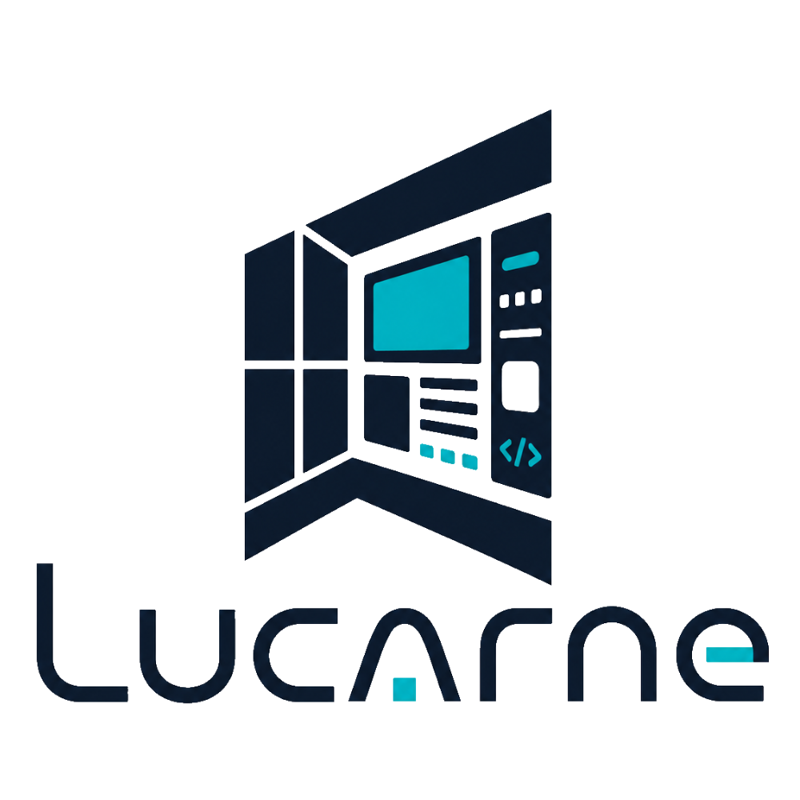
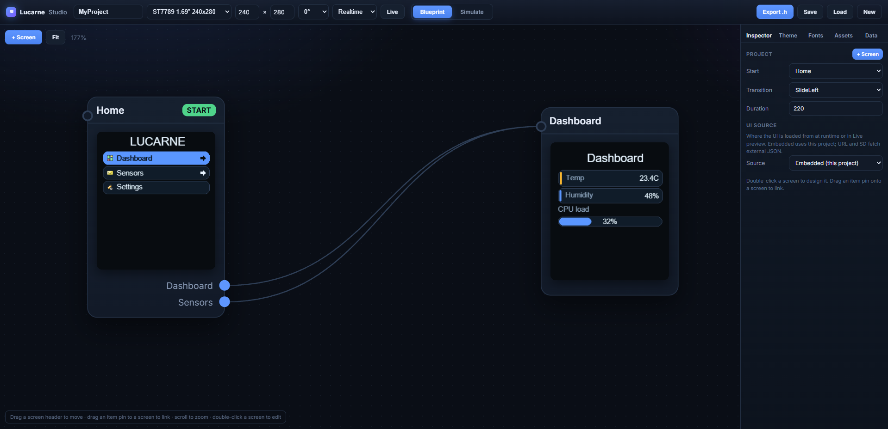
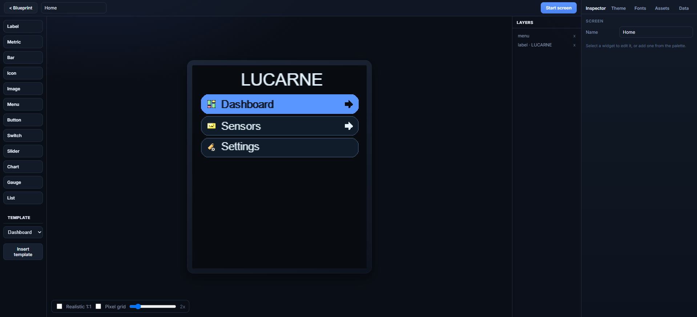
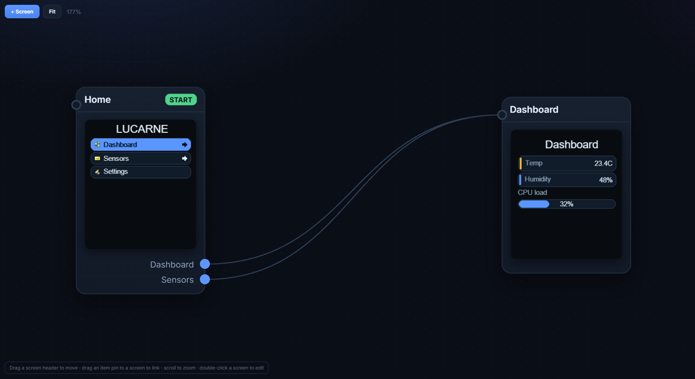

<div align="center">



# Lucarne

**UI toolkit for small SPI displays on Arduino and ESP32**

Standalone drivers, a lightweight UI runtime, and a visual web Studio with C++ export.

[](https://github.com/Pupariaa/Lucarne/releases)
[](https://github.com/Pupariaa/Lucarne/releases)
[](LICENSE)
[](https://www.ardu-badge.com/Lucarne)
[](https://www.arduino.cc/)
[](https://platformio.org/)
[](https://www.espressif.com/)
[](docs/HARDWARE.md)
[](docs/HARDWARE.md)
[](docs/HARDWARE.md)
[](docs/HARDWARE.md)
[](https://ko-fi.com/pupsbot)

[Documentation](https://lucarnelib.techalchemy.fr/doc/) · [Studio](https://lucarnelib.techalchemy.fr/editor/) · [Issues](https://github.com/Pupariaa/Lucarne/issues) · [Releases](https://github.com/Pupariaa/Lucarne/releases)

</div>

### Preview

<p align="center">
  
  
  
</p>

<p align="center">
  <sub><strong>Studio</strong> — design screens, wire menu flows, export <code>Projet.h</code></sub><br />
  <sub><strong>Live Preview</strong> (ESP32-S3 + USB) —  see <a href="docs/LIVE_PREVIEW.md">docs/LIVE_PREVIEW.md</a></sub>
</p>

> **Hardware photos / demo GIF** — real panel shots and an *editor → export → screen* clip are planned. If you have a clean setup photo, [open a PR](CONTRIBUTING.md).

### Project status

| | |
| --- | --- |
| **Stage** | **Experimental / alpha** (`v0.3.0`) — API, export format, and Studio behaviour may change between minor releases. |
| **Firmware** | Tested on real boards (see [compatibility matrix](#compatibility-matrix) below). Report your combo in [Issues](https://github.com/Pupariaa/Lucarne/issues). |
| **Studio** | Usable online or locally; Live Preview targets **ESP32-S3** with USB CDC. |
| **Stability** | Suitable for prototypes and personal projects; pin a [release tag](https://github.com/Pupariaa/Lucarne/releases) for anything production-critical. |

---

## Table of contents

- [Overview](#overview)
- [Features](#features)
- [Compatibility matrix](#compatibility-matrix)
- [Installation](#installation)
- [Quick start](#quick-start)
- [UI in code](#ui-in-code)
- [Lucarne Studio](#lucarne-studio)
- [Exported projects](#exported-projects)
- [Widgets](#widgets)
- [Examples](#examples)
- [Memory modes](#memory-modes)
- [Documentation](#documentation)
- [Repository layout](#repository-layout)
- [Contributing](#contributing)
- [License](#license)

---

## Overview

Lucarne targets **small color SPI panels** (ST7789, ST7735S, ST7796, ILI9342) on **Arduino** and **ESP32**, plus **MIPI-DSI panels on ESP32-P4** (HX8394 panel IC, via `MipiDisplay`). It combines three layers:

| Layer | Role |
| --- | --- |
| **Graphics** | SPI / MIPI-DSI drivers, drawing primitives, optional framebuffer |
| **UI runtime** | Screens, widgets, menus, transitions, data binding |
| **Lucarne Studio** | Browser editor: design, simulate, export `Projet.h` |

No Adafruit GFX dependency. No LVGL-style heavyweight renderer on the device: design in Studio, ship static C++ headers.

---

## Features

- **ST7789, ST7735S, ST7796 & ILI9342** SPI drivers, plus **MipiDisplay** for MIPI-DSI panels on **ESP32-P4** (HX8394 panel IC) — panel offsets and rotation
- **Framebuffer modes** — full (transitions + partial flush) or direct draw
- **PSRAM-aware** allocation with automatic fallback
- **Widgets** — labels, metrics, bars, icons (static, color, animated), menus, images (flash, RLE flash, SD, volume, or PSRAM), buttons, shapes, switches, text fields (with on-device keyboard), sliders, charts, graphs, gauges, lists, plus store-bound battery/clock/date/status/dynamic-image indicators
- **Animated transitions** — slide, fade, push, cover, and more
- **Data binding** — named keys (`ui.setFloat("temp", …)`) drive widget updates
- **Physical input** — GPIO buttons, rotary encoder, touch feed; **GT911** I2C touch implemented for the MIPI/ESP32-P4 path
- **Lucarne Studio** — visual designer, blueprint, simulation, project wizards, GPIO/DRC checks, C++ export
- **Live Preview** — stream the framebuffer to an ESP32-S3 over USB (Chrome/Edge)
- **Built-in fonts** — anti-aliased Fira Sans (`LucarneFontBody`, `LucarneFontTitle`)

---

## Compatibility matrix

Legend: ✓ supported · ~ constrained · ✗ not supported

### MCUs

All boards below have been exercised with Lucarne on SPI displays. Capabilities depend on **RAM**, **PSRAM**, and panel size.

| MCU | UI + SPI | `BufferMode::Full` | Animated transitions | USB Live Preview | PSRAM |
| --- | :---: | :---: | :---: | :---: | :---: |
| **ESP32** (WROOM-32D) | ✓ | ✓ | ✓ | ~ | ✓ |
| **ESP32-S3** | ✓ | ✓ | ✓ | ✓ | ✓ |
| **ESP32-C3** | ✓ | ~ | ~ | ✗ | ~ |
| **ESP32-C5** | ✓ | ✓ | ✓ | ~ | ✓ |
| **ESP32-C6** | ✓ | ~ | ~ | ✗ | ~ |
| **ESP32-P4** | ✓ | ✓ | ✓ | ~ | ✓ |
| **ESP32-H4** | ✓ | ✓ | ✓ | ~ | ✓ |
| **ESP8266** | ✓ | ~ | ✗ | ✗ | ✗ |
| **RP2040** (Pico, etc.) | ✓ | ~ | ~ | ✗ | ✗ |
| **RP2350** (Pico 2, etc.) | ✓ | ✓ | ~ | ✗ | ✗ |
| **ATmega328P** | ✓ | ✗ | ✗ | ✗ | ✗ |
| **ATmega32U4** | ✓ | ~ | ✗ | ✗ | ✗ |
| **ATmega2560** | ✓ | ~ | ✗ | ✗ | ✗ |

**Notes**

- **`BufferMode::Full`** needs ~2 bytes × width × height (+ transition snapshots). Lucarne falls back to **`BufferMode::None`** automatically if allocation fails.
- **Animated transitions** require `BufferMode::Full` and enough free RAM for temporary buffers.
- **USB Live Preview** is validated on **ESP32-S3** (USB CDC On Boot). Other ESP32 variants may work with USB CDC but are not the primary target; not implemented/tested on RP2040/RP2350 or AVR.
- **PSRAM** is not mandatory but strongly recommended on ESP32/S3 for 240×240 panels and larger, fonts, and transitions. **ST7796 320×480** full framebuffer needs ~307 KB — use ESP32-S3 with PSRAM or ESP32-P4.
- **RP2040/RP2350** (Earle Philhower's `rp2040:rp2040` Arduino core, `arduino-pico`): SPI drivers and the UI runtime compile and run — `BufferMode::Full` fits on RP2350's 520 KB SRAM for panels up to ST7796 320×480, and on RP2040's 264 KB SRAM for smaller panels (e.g. ST7789 240×280). `BufferMemory::Psram`/`ImageStorage::Psram` are **not backed by real PSRAM** here — Lucarne's PSRAM allocator only calls ESP-IDF's `heap_caps_malloc`, so on RP2040/RP2350 they silently fall back to a normal `malloc()` from internal SRAM. Wire up custom SPI/I2C pins with `SPI.setSCK()`/`setTX()`/`setRX()` and `Wire.setSDA()`/`setSCL()` **before** `display.begin()` (Lucarne Studio's exporter does this automatically for RP-family boards).
- **AVR** targets: use small panels (e.g. ST7735S 128×160), `BufferMode::None`, and keep UI complexity low.

### Displays

| Panel | Driver | ESP32 family | RP2040/RP2350 | ESP8266 | AVR |
| --- | --- | :---: | :---: | :---: | :---: |
| ST7789 135×240 | ST7789 | ✓ | ✓ | ~ | ~ |
| ST7789 240×240 | ST7789 | ✓ | ✓ | ~ | ✗ |
| ST7789 172×320 | ST7789 | ✓ | ✓ | ✗ | ✗ |
| ST7789 240×280 | ST7789 | ✓ | ✓ | ✗ | ✗ |
| ST7789 240×320 | ST7789 | ✓ | ✓ (RP2350) / ~ (RP2040) | ✗ | ✗ |
| ST7796 320×480 | ST7796 | ✓ (PSRAM) | ✓ (RP2350 only, no PSRAM) | ✗ | ✗ |
| ILI9342C 240×320 | ILI9342 | ✓ | ✓ (RP2350) / ~ (RP2040) | ✗ | ✗ |
| ILI9342C 320×240 | ILI9342 | ✓ | ✓ (RP2350) / ~ (RP2040) | ✗ | ✗ |
| ST7735S 80×160 | ST7735S | ✓ | ✓ | ✓ | ✓ |
| ST7735S 128×128 | ST7735S | ✓ | ✓ | ~ | ~ |
| ST7735S 128×160 | ST7735S | ✓ | ✓ | ✓ | ✓ |

### MIPI-DSI displays (ESP32-P4 only)

| Panel | Panel IC | Driver | `MipiPanelDriver` | Status |
| --- | --- | --- | --- | --- |
| Waveshare 5-DSI-TOUCH-A 720×1280 | HX8394 | `MipiDisplay` | `Ws5DsiTouchA_Hx8394` | ✓ supported |
| Generic ILI9881C panel (Espressif reference, 800×1280) | ILI9881C | `MipiDisplay` | `Ili9881c` | ✓ supported (generic reference init/timing — some third-party modules ship their own gamma/power tuning and porches) |
| 10.1" MIPI panels (commonly 800×1280, e.g. Waveshare 10.1") | JD9365 | `MipiDisplay` | `Jd9365` | ✓ supported |
| ESP32-P4-Function-EV-Board panel 1024×600 | EK79007 | `MipiDisplay` | `Ek79007` | ✓ supported |

| Touch IC | Bus | Class | Status |
| --- | --- | --- | --- |
| GT911 | I2C (shared with panel) | `GT911Touch` | ✓ supported |
| GT9271 | I2C (shared with panel) | `GT9271Touch` | ✓ supported (same Goodix register protocol as GT911) |
| GT928 | I2C (shared with panel) | `GT928Touch` | ✓ supported (same Goodix register protocol as GT911) |
| FT6336 (and FT6206/FT6236 siblings) | I2C (shared with panel) | `FT6336Touch` | ✓ supported |

`MipiDisplay` needs an ESP32-P4 (MIPI-DSI peripheral) with PSRAM for its framebuffer. Any panel driver can be paired with any touch class above — they all share the panel's I2C bus (`display.i2cBus()`). See [`examples/LucarneUIP4MultiPanel`](examples/LucarneUIP4MultiPanel/LucarneUIP4MultiPanel.ino) for a sketch that switches between all four panels and four touch options. Lucarne Studio (the web editor) does not have an ESP32-P4/MIPI-DSI board picker yet — this hardware is currently only usable by writing the sketch directly against the `Lucarne` C++ library, see [`docs/HARDWARE.md`](docs/HARDWARE.md#mipi-dsi--esp32-p4) and [`docs/DISPLAY_ROADMAP.md`](docs/DISPLAY_ROADMAP.md).

Pin wiring, SPI modes, offsets: [`docs/HARDWARE.md`](docs/HARDWARE.md).

---

## Installation

### Arduino IDE

1. **Library Manager** — **Sketch → Include Library → Manage Libraries**, search `Lucarne`, install.
2. Or download / clone this repository and copy the folder to `Documents/Arduino/libraries/Lucarne`.
3. Restart the IDE.
4. Open **File → Examples → Lucarne**.

### PlatformIO

Add to `platformio.ini`:

```ini
lib_deps =
    file://../Lucarne
```

Or place the library under `lib/Lucarne/` in your project.

### Include

```cpp
#include <Lucarne.h>
using namespace lucarne;
```

---

## Quick start

Minimal sketch — draw text on an ST7789 panel:

```cpp
#include <Lucarne.h>
using namespace lucarne;

ST7789 display;

void setup() {
    DisplayPins pins;
    pins.cs = 5;
    pins.dc = 16;
    pins.rst = 17;
    pins.mosi = 21;
    pins.sclk = 18;

    DisplayOptions options;
    options.panelWidth = 240;
    options.panelHeight = 280;
    options.spiMode = 3;
    options.invert = true;

    BufferOptions buffer;
    buffer.mode = BufferMode::Full;

    display.begin(pins, options, buffer);
    display.fillScreen(color565(0, 0, 0));
    display.setCursor(20, 20);
    display.setTextColor(color565(255, 255, 255));
    display.print("Hello Lucarne");
    display.display();
}

void loop() {}
```

> **Black screen?** Try `options.spiMode = 3` and `options.invert = true`. Run the `LucarneDiag` example to validate wiring.

---

## UI in code

```cpp
ST7789 display;
UI ui(display);
Screen dashboard("Dashboard");

Label title(0, 14, "Dashboard", TextAlign::Center);
Metric temp(14, 56, 212, 34, "Temp", "temp", "C");
Bar loadBar(14, 166, 212, 20, "load", 0.0f, 1.0f);

void setup() {
    display.begin(/* pins, options, buffer */);

    Theme theme;
    theme.font = &LucarneFontBody;
    theme.fontTitle = &LucarneFontTitle;
    ui.setTheme(theme);

    dashboard.add(&title);
    dashboard.add(&temp);
    dashboard.add(&loadBar);

    ui.setFloat("temp", 23.4f);
    ui.setFloat("load", 0.32f);
    ui.show(&dashboard);
    ui.begin();
}

void loop() {
    ui.setFloat("temp", readTemperature());
    ui.update();
}
```

**Menus, transitions, callbacks, buttons** — see [`examples/LucarneMenu`](examples/LucarneMenu/LucarneMenu.ino) and [`docs/RUNTIME.md`](docs/RUNTIME.md).

**Data binding keys:** `ui.setFloat`, `ui.setInt`, `ui.setBool`, `ui.setString`. Widgets bound to a key redraw only when the value changes.

---

## Lucarne Studio

Design screens in the browser, wire up hardware, simulate navigation, export firmware-ready headers.

| Mode | Purpose |
| --- | --- |
| **Blueprint** | Connect screens through menu links |
| **Designer** | Place widgets, edit theme and layout |
| **Simulate** | Keyboard, on-screen D-pad, or touch — test navigation and transitions |

- **New Project Setup Wizard** — multi-step flow: name/template, display + rotation, board/MCU, input method, then a review step with automatic GPIO assignment
- **GPIO wizard** — auto-assigns conflict-free pins for the selected board
- **Design Rule Check (DRC)** — validates board, GPIO, buses, screens, keys, and asset storage before export
- **Flash receiver wizard** — flashes a precompiled generic receiver sketch onto an ESP32-S3 over WebSerial (in-browser `esptool-js`), so **Live** has something to talk to without hand-flashing
- **Live Preview** — stream the framebuffer over USB serial (the **Live** button), with a `HWCONFIG` handshake that reconfigures the receiver's hardware at runtime
- **Project Settings dialog** — Theme / Fonts / Hardware / Assets / Data tabs
- **Calculated keys** — formula-based global keys, configured in the Data tab
- **Layers panel** — drag to reorder widget stacking order (z-order)
- **Undo/redo** — full history bar
- **Project manager** — multiple projects stored in the browser (`localStorage`)
- **Memory bar** — live flash / internal-storage / PSRAM usage estimate against the selected board's real limits
- **Export** — generates a ready-to-compile `.ino` sketch plus C++ headers (and SD/Volume asset files with a manifest when relevant); a fresh project needs zero hand-written code

- **Online:** [lucarnelib.techalchemy.fr/editor](https://lucarnelib.techalchemy.fr/editor/)
- **Local:** open `editor/index.html` in a browser (no build step)
- **Live Preview:** run the Flash receiver wizard, or flash [`examples/LucarnePreview`](examples/LucarnePreview/LucarnePreview.ino) / [`examples/LucarnePreviewST7796`](examples/LucarnePreviewST7796/LucarnePreviewST7796.ino) manually, then click **Live** in the editor ([guide](docs/LIVE_PREVIEW.md))

Full editor reference: [`docs/EDITOR.md`](docs/EDITOR.md).

---

## Exported projects

Drop exported headers next to your sketch. Copy SD binaries from Studio **Files (SD)** onto a FAT32 card (see `SD_MANIFEST.txt`).

```cpp
#include <Lucarne.h>
#include "Projet.h"
#include "Projet_setup.h"

using namespace lucarne;

ST7789 display;
UI ui(display);

void setup() {
    BufferOptions buffer;
    buffer.mode = BufferMode::Full;

    projet::initSpiBus();
    display.begin(projet::displayPins(), projet::displayOptions(), buffer, &SPI);
    projet::mountSdCard();

    projet::build(ui);
    projet::attachInput(ui);
    ui.begin();
}
```

| Export tab | Contents |
| --- | --- |
| **Headers** | `Projet.h`, `Projet_setup.h`, optional `Projet_fonts.h`, `Projet_images.h`, `Projet_icons.h` |
| **Files (SD)** | `assets/*.rgb565`, `SD_MANIFEST.txt` |

Pin wiring and SD layout are configured in Studio **Hardware** and emitted in `Projet_setup.h`. Details: [`docs/SD.md`](docs/SD.md).

---

## Widgets

| Widget | Description |
| --- | --- |
| `Label` | Static or bound text |
| `Metric` | Title + large value + unit |
| `Bar` | Horizontal progress bar |
| `Icon` | Tabler / mono / color / animated icon by ref |
| `Menu` | Navigable list with icons and transitions |
| `Image` | Flash, RLE flash, SD, volume, or PSRAM RGB565 bitmap |
| `Button` | Tappable control with callback id |
| `Shape` | Rect / circle / triangle with fill and stroke, focusable for D-pad navigation |
| `Switch` | On/off toggle |
| `TextField` | Text or number input with an on-device virtual keyboard |
| `Slider` | Numeric value slider |
| `Chart` | Simple series chart |
| `Graph` | Line, bar, area, or sparkline graph fed by streamed or keyed values |
| `List` | Scrollable text list |
| `Gauge` | Arc gauge |
| `Battery` | Battery level indicator with optional charging state |
| `Clock` | Store-bound clock, configurable time format |
| `Date` | Store-bound date, configurable date format |
| `Status` | Wi-Fi / RSSI / Bluetooth status indicator |
| `DynamicImage` | Runtime-selected image path bound to a store key |

API details: [`docs/RUNTIME.md`](docs/RUNTIME.md) · [online API reference](https://lucarnelib.techalchemy.fr/doc/#api).

---

## Examples

| Sketch | Description |
| --- | --- |
| [`HelloLucarne`](examples/HelloLucarne/HelloLucarne.ino) | Minimal getting-started sketch — low-level drawing and text |
| [`LucarneDiag`](examples/LucarneDiag/LucarneDiag.ino) | ST7789 generic wiring / full-screen RGB test pattern |
| [`LucarneDiagS3`](examples/LucarneDiagS3/LucarneDiagS3.ino) | ESP32-S3 pin variant of the wiring diagnostic |
| [`LucarneDiagST7796`](examples/LucarneDiagST7796/LucarneDiagST7796.ino) | ST7796 panel wiring / diagnostic |
| [`LucarneMenu`](examples/LucarneMenu/LucarneMenu.ino) | Menu navigation, button input, and transitions |
| [`LucarneUI`](examples/LucarneUI/LucarneUI.ino) | Store-bound dashboard with `Metric` and `Bar` widgets |
| [`LucarneUIP4`](examples/LucarneUIP4/LucarneUIP4.ino) | ESP32-P4 MIPI-DSI display + GT911 touch |
| [`LucarnePreview`](examples/LucarnePreview/LucarnePreview.ino) | Studio Live Preview receiver, ST7789 |
| [`LucarnePreviewST7796`](examples/LucarnePreviewST7796/LucarnePreviewST7796.ino) | Studio Live Preview receiver, ST7796 / PSRAM boards |
| [`LucarneKeyboard`](examples/LucarneKeyboard/LucarneKeyboard.ino) | `TextField` and the on-device virtual keyboard |

---

## Memory modes

| `BufferMode` | RAM usage | Transitions |
| --- | --- | --- |
| `Full` | Framebuffer (PSRAM or internal) | Animated |
| `None` | Minimal | Instant only |

`BufferMemory::Auto` prefers PSRAM when available. Set `maxBytes` to cap allocation; Lucarne falls back to direct mode if memory is insufficient.

---

## Documentation

| Resource | Link |
| --- | --- |
| **Online manual** (FR/EN) | [lucarnelib.techalchemy.fr/doc](https://lucarnelib.techalchemy.fr/doc/) |
| Changelog | [`CHANGELOG.md`](CHANGELOG.md) |
| Runtime API | [`docs/RUNTIME.md`](docs/RUNTIME.md) |
| Studio & export | [`docs/EDITOR.md`](docs/EDITOR.md) |
| Images, icons, opaque bake | [`docs/ASSETS.md`](docs/ASSETS.md) |
| SD card assets | [`docs/SD.md`](docs/SD.md) |
| Internal partition assets | [`docs/VOLUME.md`](docs/VOLUME.md) |
| Live Preview | [`docs/LIVE_PREVIEW.md`](docs/LIVE_PREVIEW.md) |
| Wiring & panels | [`docs/HARDWARE.md`](docs/HARDWARE.md) |
| Custom fonts | [`docs/FONTS.md`](docs/FONTS.md) |

---

## Repository layout

```
Lucarne/
├── src/              Firmware SDK (display, UI, widgets)
├── editor/           Lucarne Studio (web app)
├── examples/         Arduino sketches
├── docs/             Reference guides + online manual source
├── images/           Brand assets
├── site/             Project website sources
├── scripts/          Build tools (web, fonts, icons)
├── library.properties
├── keywords.txt
└── LICENSE
```

---

## Contributing

Contributions are welcome: bug reports, examples, docs, and pull requests.

1. Open an [issue](https://github.com/Pupariaa/Lucarne/issues) for bugs or feature ideas.
2. Fork the repo and create a branch from `main`.
3. Keep changes focused; match existing code style.
4. Open a pull request with a clear description and test notes (board + panel if relevant).

See [`CONTRIBUTING.md`](CONTRIBUTING.md) for details.

**Releases** follow [Semantic Versioning](https://semver.org/). Git tags match `library.properties` (`v0.1.0` → version `0.1.0`).

---

## Support

Lucarne is open source and free to use. If it helps your projects, you can [support development on Ko-fi](https://ko-fi.com/pupsbot).

---

## License

Lucarne is released under the [MIT License](LICENSE).

Default UI fonts use **Fira Sans** ([SIL Open Font License 1.1](https://scripts.sil.org/OFL)). Custom fonts exported from Studio may carry their own licenses.

---

<div align="center">

Made by [Techalchemy](https://techalchemy.fr/)

</div>
